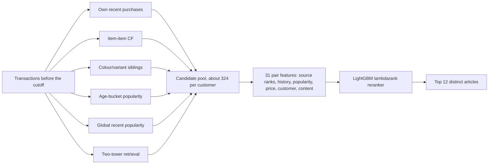
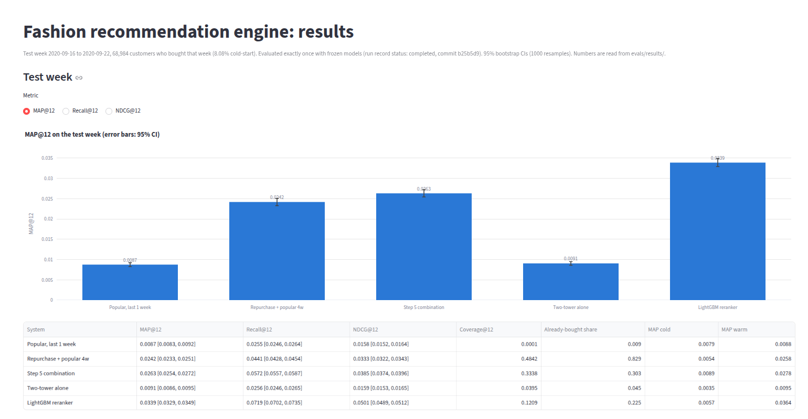
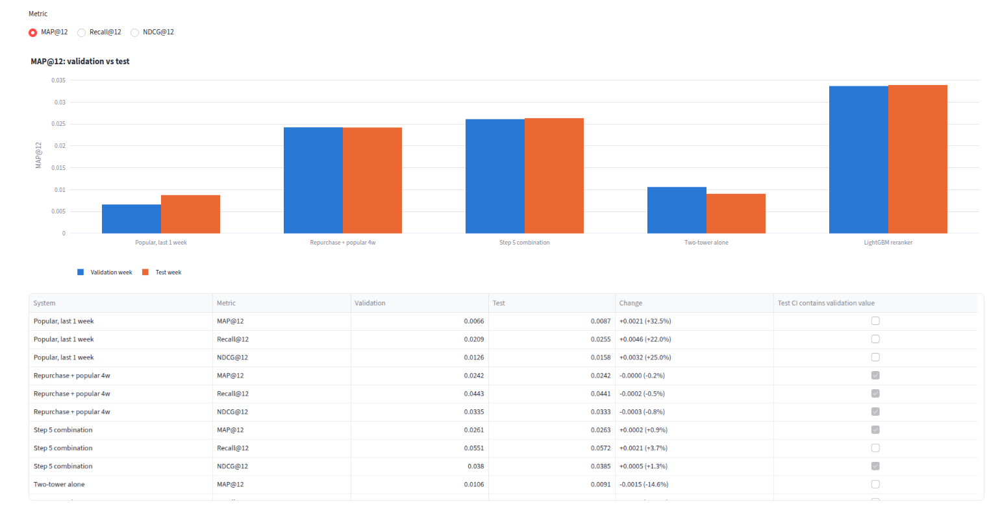

# Fashion Recommendation Engine (H&M)

A two-stage recommender for the H&M fashion catalogue: several candidate generators feed a LightGBM reranker, evaluated
offline with a time-based split, a locked test week, and bootstrap confidence intervals. Everything here is code plus aggregate
result files; the H&M data is not included.

> This README is generated by `scripts/render_readme_tables.py` from the files in `evals/results/`
> (template: `docs/README.template.md`), so every number below comes from a saved run.

## Problem statement

Given a customer's purchase history up to a cutoff, rank 12 articles they are likely to buy in the following 7 days.
Quality is measured with MAP@12 (Kaggle style), Recall@12 and NDCG@12 over customers who bought in the target week.

## Data and licence note

The data comes from the Kaggle competition
[H&M Personalized Fashion Recommendations](https://www.kaggle.com/competitions/h-and-m-personalized-fashion-recommendations)
and is used here for educational, non-commercial purposes under the competition rules. **It is not included in this repository**
(the rules forbid redistribution), no raw files, samples or images are committed, and the app never shows product images.
The code is MIT-licensed (see `LICENSE`); the data stays covered by the Kaggle competition rules.

### How to get the data

1. Accept the competition rules on Kaggle (this may require phone verification).
2. Download `articles.csv`, `customers.csv` and `transactions_train.csv` (not the images) into `data/raw/`, from the competition's
   Data tab or with the kaggle CLI, e.g. `kaggle competitions download -c h-and-m-personalized-fashion-recommendations -f articles.csv -p data/raw`
   (repeat for each file and unzip).
3. Run `python scripts/convert_to_parquet.py` to write Parquet files to `data/processed/`.

The kaggle CLI is a download tool only and is not in `requirements.txt`. Use a recent version (2.x needs Python 3.11 or later)
with an access token kept in `~/.kaggle/`; never commit it.

## Evaluation protocol

- **Time split** (derived from the last date in the data): train before 2020-09-09, validation week 2020-09-09 to 2020-09-15 (cutoff 2020-09-09),
  test week 2020-09-16 to 2020-09-22 (cutoff 2020-09-16). Every feature, candidate source and training example only uses transactions before its cutoff
  (leakage tests cover each source and the feature builder).
- **Population:** all customers who bought in the target week: 72,019 on validation (7.49% cold-start) and 68,984 on the test week
  (5,572, 8.08%, cold-start). Cold-start means no purchase before the cutoff.
- **Confidence intervals:** customers are resampled (1000 resamples, seed 123); differences between systems use a paired bootstrap on the same customers.
- **Tuning** used the validation week and, for the reranker, inner customers of a training week; every trial is logged in `evals/results/tuning_log.csv`.
- **Locked test week:** models, features, the cold-start rule and hyperparameters were frozen and documented in
  `evals/results/test_protocol.md` before the test week was looked at. **The test week was evaluated exactly once**
  (`scripts/run_test_final.py --i-am-done-tuning`, which refuses to run a second time). The run record
  `evals/results/test_run_record.json` stores the commit (b25b5d9), timestamp (2026-10-26T12:05:42) and model hashes; its status is `completed`.
  A dry run of the identical code on the validation week reproduced the earlier validation numbers before the test run.

## System architecture



- **Candidate sources:** repurchase list, item-item cosine CF (all customers, recency-weighted), variant siblings (same `product_code`),
  age-bucket popularity, global popularity and the two-tower top 100.
- **Two-tower** (PyTorch, CPU): customer tower over the last K purchases with recency weights, age bucket and two numeric features; item tower over the
  article id plus product type, colour, department and index group; in-batch sampled softmax with a logQ correction. 6,804,136 parameters, about 51 s per epoch.
- **Reranker:** LightGBM lambdarank on 31 features, trained on the week 2020-09-02 to 2020-09-08 using 24,000 sampled customers
  (7,728,754 candidate rows), best iteration 45, early-stopped and tuned on held-out customers of that training week.

## Results

### Test week (2020-09-16 to 2020-09-22, 68,984 customers)



*Screenshot of the local Streamlit Results page (MAP@12 view), which reads only the committed result files.*

| System | MAP@12 [95% CI] | Recall@12 [95% CI] | NDCG@12 [95% CI] | Coverage@12 | Already-bought share | MAP cold | MAP warm |
|---|---|---|---|---|---|---|---|
| Popular, last 1 week | 0.0087 [0.0083, 0.0092] | 0.0255 [0.0246, 0.0264] | 0.0158 [0.0152, 0.0164] | 0.0001 | 0.009 | 0.0079 | 0.0088 |
| Repurchase + popular 4w | 0.0242 [0.0233, 0.0251] | 0.0441 [0.0428, 0.0454] | 0.0333 [0.0322, 0.0343] | 0.4842 | 0.829 | 0.0054 | 0.0258 |
| Step 5 combination | 0.0263 [0.0254, 0.0272] | 0.0572 [0.0557, 0.0587] | 0.0385 [0.0374, 0.0396] | 0.3338 | 0.303 | 0.0089 | 0.0278 |
| Two-tower alone | 0.0091 [0.0086, 0.0095] | 0.0256 [0.0246, 0.0265] | 0.0159 [0.0153, 0.0165] | 0.0395 | 0.045 | 0.0035 | 0.0095 |
| LightGBM reranker | 0.0339 [0.0329, 0.0349] | 0.0719 [0.0702, 0.0735] | 0.0501 [0.0489, 0.0512] | 0.1209 | 0.225 | 0.0057 | 0.0364 |

Paired differences on the test week (same customers):

| A - B | Metric | Difference [95% CI] | CI excludes 0 |
|---|---|---|---|
| LightGBM reranker - Step 5 combination | MAP@12 | +0.0076 [+0.0069, +0.0082] | yes |
| LightGBM reranker - Step 5 combination | Recall@12 | +0.0147 [+0.0135, +0.0160] | yes |
| LightGBM reranker - Step 5 combination | NDCG@12 | +0.0116 [+0.0108, +0.0123] | yes |
| LightGBM reranker - Repurchase + popular 4w | MAP@12 | +0.0097 [+0.0091, +0.0104] | yes |
| LightGBM reranker - Repurchase + popular 4w | Recall@12 | +0.0278 [+0.0265, +0.0290] | yes |
| LightGBM reranker - Repurchase + popular 4w | NDCG@12 | +0.0168 [+0.0160, +0.0176] | yes |

### Validation vs test

The same frozen code and models, once on the validation week (72,019 customers) and once on the test week.



*Screenshot of the local Streamlit Results page (validation vs test, MAP@12 view), which reads only the committed result files.*

| System | Metric | Validation | Test | Change | Test CI contains validation value |
|---|---|---|---|---|---|
| Popular, last 1 week | MAP@12 | 0.0066 | 0.0087 | +0.0021 (+32.5%) | no |
| Popular, last 1 week | Recall@12 | 0.0209 | 0.0255 | +0.0046 (+22.0%) | no |
| Popular, last 1 week | NDCG@12 | 0.0126 | 0.0158 | +0.0032 (+25.0%) | no |
| Repurchase + popular 4w | MAP@12 | 0.0242 | 0.0242 | -0.0000 (-0.2%) **drop** | yes |
| Repurchase + popular 4w | Recall@12 | 0.0443 | 0.0441 | -0.0002 (-0.5%) **drop** | yes |
| Repurchase + popular 4w | NDCG@12 | 0.0335 | 0.0333 | -0.0003 (-0.8%) **drop** | yes |
| Step 5 combination | MAP@12 | 0.0261 | 0.0263 | +0.0002 (+0.9%) | yes |
| Step 5 combination | Recall@12 | 0.0551 | 0.0572 | +0.0021 (+3.7%) | no |
| Step 5 combination | NDCG@12 | 0.0380 | 0.0385 | +0.0005 (+1.3%) | yes |
| Two-tower alone | MAP@12 | 0.0106 | 0.0091 | -0.0015 (-14.6%) **drop** | no |
| Two-tower alone | Recall@12 | 0.0291 | 0.0256 | -0.0035 (-12.2%) **drop** | no |
| Two-tower alone | NDCG@12 | 0.0184 | 0.0159 | -0.0025 (-13.5%) **drop** | no |
| LightGBM reranker | MAP@12 | 0.0337 | 0.0339 | +0.0002 (+0.7%) | yes |
| LightGBM reranker | Recall@12 | 0.0724 | 0.0719 | -0.0006 (-0.8%) **drop** | yes |
| LightGBM reranker | NDCG@12 | 0.0504 | 0.0501 | -0.0003 (-0.6%) **drop** | yes |

### How each stage improved things (validation week, same 72,019 customers)

| Stage (validation week) | MAP@12 [95% CI] | Recall@12 [95% CI] | NDCG@12 [95% CI] |
|---|---|---|---|
| Popular, last 4 weeks | 0.0056 [0.0053, 0.0059] | 0.0210 [0.0202, 0.0219] | 0.0118 [0.0114, 0.0123] |
| Repurchase + popular 4w | 0.0242 [0.0233, 0.0251] | 0.0443 [0.0431, 0.0456] | 0.0335 [0.0326, 0.0345] |
| Item-CF alone (200k-customer sample) | 0.0070 [0.0066, 0.0075] | 0.0167 [0.0160, 0.0174] | 0.0114 [0.0109, 0.0120] |
| Item-CF alone (all customers, recency) | 0.0098 [0.0094, 0.0103] | 0.0266 [0.0257, 0.0275] | 0.0169 [0.0164, 0.0175] |
| Step 4 combination | 0.0248 [0.0240, 0.0257] | 0.0486 [0.0473, 0.0499] | 0.0351 [0.0341, 0.0361] |
| Step 5 combination | 0.0261 [0.0253, 0.0270] | 0.0551 [0.0537, 0.0566] | 0.0380 [0.0370, 0.0390] |
| Two-tower alone | 0.0106 [0.0101, 0.0111] | 0.0291 [0.0282, 0.0301] | 0.0184 [0.0178, 0.0191] |
| LightGBM reranker | 0.0337 [0.0327, 0.0346] | 0.0724 [0.0709, 0.0740] | 0.0504 [0.0492, 0.0515] |

## Ablations (validation week)

| Variant (validation week) | MAP@12 [95% CI] | Recall@12 [95% CI] | NDCG@12 [95% CI] |
|---|---|---|---|
| reranker (full) | 0.0337 [0.0327, 0.0346] | 0.0724 [0.0709, 0.0740] | 0.0504 [0.0492, 0.0515] |
| reranker without two-tower features | 0.0335 [0.0325, 0.0344] | 0.0715 [0.0700, 0.0731] | 0.0500 [0.0488, 0.0511] |
| reranker without content features | 0.0342 [0.0332, 0.0352] | 0.0724 [0.0709, 0.0740] | 0.0509 [0.0498, 0.0520] |

| Full model minus ablated model | Metric | Difference [95% CI] | CI excludes 0 |
|---|---|---|---|
| reranker (full) - reranker without two-tower features | MAP@12 | +0.0002 [-0.0002, +0.0006] | no |
| reranker (full) - reranker without two-tower features | Recall@12 | +0.0009 [+0.0001, +0.0017] | yes |
| reranker (full) - reranker without two-tower features | NDCG@12 | +0.0004 [-0.0000, +0.0009] | no |
| reranker (full) - reranker without content features | MAP@12 | -0.0006 [-0.0010, -0.0001] | yes |
| reranker (full) - reranker without content features | Recall@12 | +0.0000 [-0.0008, +0.0009] | no |
| reranker (full) - reranker without content features | NDCG@12 | -0.0005 [-0.0011, +0.0001] | no |

Two-tower variants (the ID-only item tower and the version without logQ correction):

| Two-tower variant (validation week) | MAP@12 [95% CI] | Recall@12 [95% CI] | NDCG@12 [95% CI] |
|---|---|---|---|
| two_tower (chosen) | 0.0106 [0.0101, 0.0111] | 0.0291 [0.0282, 0.0301] | 0.0184 [0.0178, 0.0191] |
| two_tower ID-only item tower | 0.0100 [0.0096, 0.0105] | 0.0277 [0.0268, 0.0286] | 0.0174 [0.0168, 0.0181] |
| two_tower logQ flipped | 0.0050 [0.0047, 0.0054] | 0.0135 [0.0128, 0.0142] | 0.0084 [0.0079, 0.0088] |

Top features of the full reranker by share of gain:

| Feature (full reranker) | Share of total gain |
|---|---|
| art_department | 0.3489 |
| pair_prod_days_since | 0.1298 |
| art_pop_1w | 0.0774 |
| cust_weeks_since_last | 0.0474 |
| pair_dept_count | 0.0469 |
| pair_art_days_since | 0.0429 |
| art_age_days | 0.0415 |
| art_colour_group | 0.0403 |
| rank_tt | 0.0323 |
| art_product_type | 0.0316 |

Hyperparameter and design trials that were logged:

| Logged trials (evals/results/tuning_log.csv, smoke runs excluded) | Count |
|---|---|
| cold_start_rule | 3 |
| combination | 43 |
| item_cf | 5 |
| item_cf_all_customers | 14 |
| lgbm_ablation | 2 |
| lgbm_lambdarank | 5 |
| repurchase+cf+pop | 5 |
| segment_pop_age | 3 |
| segment_pop_index_group | 3 |
| two_tower | 11 |
| two_tower_final | 3 |
| variants | 5 |

## Engineering and scale

The whole pipeline, from 31,788,324 raw transactions to the frozen test evaluation, runs on a single laptop (CPU only, 7,676 MB of RAM,
8 logical CPUs, 4 threads used). It is a large-dataset-on-one-machine design, not distributed infrastructure. Figures below are copied from the
real run logs into `evals/results/runtime_memory.json`.

- **Data size and Parquet conversion.** 31,788,324 transactions, 1,371,980 customers, 105,542 articles. The raw CSVs total 3.73 GB
  (transactions alone 3.49 GB); the Parquet files total 497 MB (transactions 404 MB), a reduction of 86.7%
  overall and 88.4% for the transactions table.
- **Streamed conversion.** `scripts/convert_to_parquet.py` reads the CSV in 64 MB blocks with explicit dtypes (article ids stay strings so leading zeros survive)
  and writes zstd-compressed Parquet block by block, so the raw transactions file is never loaded whole.
- **Compact in-memory data.** Transactions are held as integer-coded arrays (day, customer code, article code) instead of strings, and only the columns a stage needs are loaded.
- **Memory-lean feature building.** Candidates and features are built in chunks of 5,000 customers; the freeze script writes them into preallocated float32 matrices, builds the LightGBM datasets
  straight from numpy arrays, and frees intermediates between stages. Reconstructing the reranker (7.7M candidate rows) peaked at 2,588 MB.
- **Memory watchdog.** The freeze and final-test scripts log memory per stage and exit without writing results if available memory drops below about 1,000 MB.
  The lowest available memory seen during the recorded runs was 2,485 MB (freeze) and 2,265 MB (final test run).
- **CPU-only training.** The 6,804,136-parameter two-tower model trains at about 51 s per epoch; the full tuning script (11 training runs covering tuning and the two ablations, plus the
  evaluation) took about 2.1 hours with a peak of 4,725 MB. The reranker validation script took about 18 minutes (peak 4,556 MB).
- **Evaluation cost.** The final test evaluation over 68,984 customers took 142 s with a peak of 2,840 MB; the identical dry run on the validation week
  took 147 s (peak 2,857 MB).

## Limitations

- **Cold-start customers are served worse.** On the test week the reranker's MAP@12 for customers with no history is far below its warm-customer value
  (see the cold and warm columns above), and below the Step 5 combination for cold customers. A cold-start fallback was pre-declared, but it was rejected by the
  rule evaluated on training-week customers, so it is not used.
- **The two-tower model is under-trained and adds little.** 8 of 11 tuning runs were still improving at the 12-epoch cap.
  Alone it scores below the Step 5 combination, it dropped between validation and test, and removing its features from the reranker changed little (see the ablation tables).
- **This is ranking quality for buyers, not conversion.** Only customers who bought in the target week are scored, so the metrics measure how well purchases
  are ranked among customers who purchase; they say nothing about whether a customer would have bought at all.
- **Reranker trained on a sample.** It was trained on 30,000 customers sampled from one training week, not the full population.
- **Catalogue limit.** Retrieval covers 50,641 articles sold in the previous 26 weeks; 5.22% of relevant (customer, article) pairs
  on the validation week are outside it (94.78% inside). The candidate pool's recall ceiling is 0.2456, against a reranked top-12 recall of 0.0724.
- **No Kaggle leaderboard score.** Nothing was submitted to Kaggle and no ranking is claimed; the evaluation here (buyers in a held-out week of the training data)
  is not comparable to the competition leaderboard.
- Item-CF and two-tower hyperparameters were chosen on the validation week, so validation numbers are slightly optimistic; the test week was not used for any choice.

## Reproduction

```bash
python3 -m venv .venv && source .venv/bin/activate
pip install -r requirements.txt
# get the data (see above), then:
python scripts/convert_to_parquet.py
python scripts/audit_data.py                 # docs/data_audit.md
python scripts/run_baselines.py              # baselines on the validation week
python scripts/run_item_cf.py                # item-CF and combination
python scripts/run_candidates.py             # better candidate generators
python scripts/run_two_tower.py              # two-tower (about 2.1 hours on CPU for the full tuning script)
python scripts/run_reranker.py               # LightGBM reranker, validation week
# scripts/freeze_reranker.py + scripts/run_test_final.py are the one-time frozen-model and test-week steps
python scripts/render_readme_tables.py       # regenerate this README from evals/results/
```

The final test run peaked at 2,840 MB of memory and took 142 s (see Engineering and scale).

### Demo app (local)

```bash
python scripts/make_demo_recs.py             # needs the data; writes data/processed/demo_recs.json (untracked)
streamlit run app/app.py
```

The "Results" page reads only the committed result files. The "Demo" page needs the untracked demo file and otherwise explains that the data is not included.

## Testing

**70 tests** (`pytest`): metrics checked against hand-calculated examples, leakage tests for every candidate source and the feature builder,
split and seed reproducibility, bootstrap properties, two-tower shapes/determinism/learning, reranker ranking and determinism, final-test guards,
and Streamlit smoke tests that run without any data.

## Project structure

```
src/fashion_recsys/   data, config (split), evaluation (metrics, bootstrap), baselines, item_cf, variants, segments,
                      two_tower, reranker, report (reads result files), memguard
scripts/              one script per stage (convert, audit, baselines, candidates, two-tower, reranker, freeze, final test, README, demo)
tests/                pytest suite (synthetic data only)
evals/results/        saved metrics, tuning log, test protocol and run record
docs/                 data audit, two-tower output format, README template
app/                  Streamlit app
```
